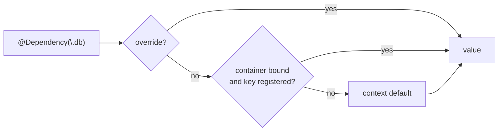

# Proposal 0001 — One DI concept, two setup styles

> Format: mini (triage score 3/6 — C1 public API, C4 crosses client/server, C5 options). Kept mini on request.
> The key words MUST, MUST NOT, SHOULD, SHOULD NOT and MAY are to be interpreted as described in RFC 2119.
> Revision 2026-10-10: the decider asked that both systems stay and work together, so the earlier "split targets, keep independent" design is replaced.

## Summary

We propose keeping both setup styles and making them one DI system: a single key type, and a `Container` that `@Dependency` consults, so that a service registered on a container is injectable with `@Dependency` and overridable with `withDependencies`. Unlike two independent systems, a consumer picks a style per module, not a library, at the cost of a bridge to maintain.

## Context and problem

`Sources/CascadeKit/CascadeKit.swift` holds two independent systems:

- `@Dependency`: task-local, value-typed, implicit, resolves on access (`:120-336`).
- `Container`/`Factory`: explicit `register`/`make`, app→request hierarchy, singleton/transient (`:338-448`).

They share only `Storage` and `Lock`, have three unrelated key protocols (`StorageKey`, `DependencyKey`, `ServiceKey`), and the only statement of independence is a comment (`:343`). A service registered on a container cannot be read with `@Dependency`, and a `@Dependency` default cannot come from a container. Consumers must choose one system or wire both by hand.

## Goals and non-goals

**Goals**

- **G1** — One key type declares a service; both `register`/`make` and `@Dependency` use it.
- **G2** — With a container bound, `@Dependency(\.x)` returns the container's registration for `x` (test).
- **G3** — Resolution order is fixed and documented: explicit override, then bound container, then context default (`liveValue`/`testValue`/`previewValue`). In `.test` context the container is consulted only if bound inside `withTestDependencies`, so a forgotten override still reaches `testValue` (0006).
- **G4** — Transient factories read `@Dependency` under the caller's values; singleton factories run under root `DependencyValues` (no overrides, container bound), so a request or test override is never captured in an app-wide singleton (test for each).
- **G5** — A consumer that only uses `@Dependency` pays nothing for the container (no new required setup).

**Non-goals**

- **NG1** — One lifetime model: `@Dependency` defaults stay cached-once (live) and the container keeps singleton/transient.
- **NG2** — Renaming types (see 0002) or fixing singleton races (see 0003).
- **NG3** — Target layout. Whether to split into several targets is a separate follow-up proposal; this one only needs the bridge.

## Proposal



**One key.** The key protocol from 0007 gains the `@Dependency` defaults:

```text
protocol StorageKey { associatedtype Value: Sendable }          // container-only keys (0007 removes ServiceKey)
protocol DependencyKey: StorageKey, Sendable { static var liveValue: Value; testValue; previewValue }
```

A `DependencyKey` is also a `StorageKey`, so the same type works in both styles. `Sendable` stays on `DependencyKey` (0007 NG2); `testValue` defaults follow 0006.

**Style 1, implicit (mobile, tests):** unchanged call sites.

```text
@Dependency(\.apiClient) var apiClient
withDependencies { $0.apiClient = .mock } operation: { … }
```

**Style 2, explicit (server, composition root):** register once, bind it.

```text
let app = AppScope()
app.register(DatabaseKey.self) { _ in PostgresPool(url: url) }
withDependencies { $0.container = app } operation: { @Dependency(\.database) var db … }
```

`DependencyValues` gains `container: (any Container)?`. Lookup uses a new `Container.resolveIfRegistered(_:) -> Value?` (non-trapping, walks `parent`; shares the singleton path with `make`). A `Request` bound per request makes request-scoped overrides and app singletons both visible through `@Dependency`.

**Placement.** `resolveIfRegistered` is a requirement of the `Container` protocol with a default implementation next to `register`/`make`, so `DependencyValues` needs no knowledge of `Factory`. Everything stays in the one `CascadeKit` target for now (NG3). 0007's `ServiceLifetime` stays with `Factory`.

**Re-entry.** A factory for `X` that reads `@Dependency(\.x)` resolves back to `X`. Under 0003's once-cell that would deadlock, so this proposal depends on 0003 trapping same-key re-entry within one task (0003 NG2 is narrowed accordingly) and adds a test.

**Propagation.** The bound container is a reference carried in the task-local, so it follows 0008's rules: it does not cross `Task.detached`, which uses the capture snippet.

**Debugging.** In debug builds, a hook reports which source (override, container, default) satisfied each key.

| Case | Behaviour |
| --- | --- |
| Container bound, key not registered | Falls to the context default |
| Container bound, key registered, override present | Override wins |
| Test context, container bound outside `withTestDependencies` | Container ignored; `testValue` used |
| Test context, container bound inside `withTestDependencies` | Container registration wins over `testValue` |
| Factory reads `@Dependency` (singleton) | Root values, no overrides |
| Factory reads `@Dependency` (transient) | Caller's values |
| Factory re-enters its own key | Trap (via 0003) |
| No container bound | Behaviour identical to v1 |

## Alternatives considered

| Option | For | Against | Verdict |
| --- | --- | --- | --- |
| Do nothing (two independent systems) | Zero work | Choose one or wire by hand; three key protocols | Rejected |
| Split into independent targets (earlier draft) | Smaller surface for mobile | Keeps two systems that cannot cooperate | Rejected by decider |
| Container only, drop `@Dependency` | One style | Loses test overrides via task-local | Rejected |
| `@Dependency` only, drop `Container` | Smallest | Loses scoped app→request singletons | Rejected |
| swift-dependencies | Off-the-shelf | Third-party; no container hierarchy | Rejected |
| Seed overrides from a container (`withDependencies { $0.use(app) }` copies registrations) | No `container` field, no per-access lookup | Request-scoped lazy singletons cannot be seeded eagerly | Rejected |
| Bridge (this proposal) | Both styles, one key | Bridge code and a resolution order to maintain | Chosen |

## Risks

- **Compatibility:** v2 may break; no-container behaviour is unchanged (G5).
- **Concurrency:** bound container is read on every `@Dependency` access; `resolveIfRegistered` takes one lock round-trip. Singleton races fixed in 0003 apply to both styles.
- **Surprise:** a container bound inside a test scope could hide a real service; bound only explicitly there, see G3 and 0006.
- **Rollback:** revert the release; no container bound means v1 behaviour, but the key protocol changes (0007) are API changes.

## Open questions

1. Decider to confirm: `.test` ignores the container unless bound inside `withTestDependencies` (draft position, matches 0006). (needs: Amine)
2. Does anyone use `Container` today? Informs priority, no longer whether it survives. (needs: Amine)

## Review log

| Date | Reviewer | Verdict | Changes made |
| --- | --- | --- | --- |
| 2026-10-10 | design-proposal-reviewer | Yes, if… (on revision 1, the independent-split design) | Superseded by revision 2 |
| 2026-10-10 | design-proposal-reviewer | Yes, if… (revision 2, bridge) | Test-context rule decided and aligned with 0006; singleton factories use root values; re-entry made depend on 0003; target split cut to a follow-up (NG3); `Sendable` reconciled with 0007; seeding alternative added; propagation tied to 0008 |

## Decision

<!-- Filled at closing. -->

## Amendments

<!-- Append-only after acceptance. -->
